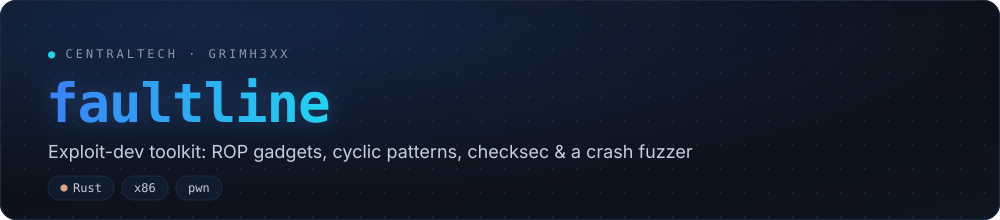

[](https://github.com/grimh3xx/faultline/actions)
[](LICENSE)


**An exploit-development toolkit in Rust.** The primitives you reach for when
developing a memory-corruption exploit or working a CTF pwn challenge, in one
dependency-light binary: **ROP gadget discovery**, **De Bruijn offset patterns**,
a **mitigation summary** (checksec), **bad-character** buffers, and a
**dumb-mutation crash fuzzer**.

<p align="center"></p>

> For binaries you own or are authorized to test (your own challenges, lab VMs,
> CTF targets, research).

## Commands

| | |
|---|---|
| `faultline checksec <bin>` | NX · PIE/ASLR · RELRO · stack canary · FORTIFY · RWX segment · stripped, for ELF |
| `faultline gadgets <bin>`  | ROP (and `--jop`) gadgets via the pure-Rust iced-x86 disassembler, with `--filter` |
| `faultline cyclic <len>`   | generate a pwntools-compatible De Bruijn pattern |
| `faultline cyclic --offset <value>` | find the offset of the value that landed in RIP/EIP |
| `faultline badchars`       | emit a `\x01..\xff` test buffer minus `--exclude`ed bytes |
| `faultline fuzz --target <bin>` | feed mutated inputs to a target and save crashing cases |

## Install

```bash
git clone https://github.com/grimh3xx/faultline
cd faultline
cargo build --release   # ./target/release/faultline
```

Pure Rust (goblin + iced-x86); no system libraries, no Python.

## A pwn workflow

```bash
# 1. What are we up against?
faultline checksec ./vuln
#   NX ✓   PIE ✗   RELRO ~ partial   Canary ✗   RWX ✓

# 2. Find the saved-return-address offset
faultline cyclic 200 | ./vuln                 # crashes; read RIP in gdb, e.g. 0x6161616c6161616b
faultline cyclic --offset 0x6161616c6161616b -n 8
#   ✓ offset 72

# 3. Build the ROP chain
faultline gadgets ./vuln --filter 'pop rdi'
#   0x0000000000401263  pop rdi; ret
faultline gadgets /lib/x86_64-linux-gnu/libc.so.6 --filter 'syscall ; ret'

# 4. Hunt fresh crashes in a suspect parser
faultline fuzz --target ./parser --seed sample.bin --iterations 20000 --out crashes
#   ✓ sig 11 after 184 bytes → crashes/crash_0931_sig11.bin
```

Every command takes `--json` for scripting (`faultline gadgets ./vuln --json | jq ...`).

## Notes

- **Gadgets** — scans every executable section, walks back from each `ret` /
  `ret imm16` (and, with `--jop`, indirect `jmp`/`call`) keeping only clean,
  linear instruction streams; results are de-duplicated and addresses are the
  virtual addresses (offsets from base for PIE). ELF and PE.
- **checksec** — read straight from ELF program headers, the dynamic section and
  symbol tables. (PE mitigation flags are on the roadmap.)
- **cyclic** — pwntools-compatible (lowercase alphabet, subsequence length 4 by
  default; use `-n 8` for 64-bit saved addresses).
- **fuzz** — a triage aid, not coverage-guided: it mutates (bit flips,
  interesting bytes, growth, truncation) and records inputs that crash the target
  (SIGSEGV/SIGABRT/SIGBUS/SIGILL/SIGFPE). Minimise and analyse the saved cases by
  hand.

## Roadmap

- [ ] ROP chain auto-assembly (`pop rdi; ret` → `execve` chains) from found gadgets
- [ ] PE/Mach-O mitigation flags in checksec
- [ ] `.rodata` string / `/bin/sh` finder
- [ ] libc gadget + one-gadget helper
- [ ] Crash de-duplication and minimisation for the fuzzer

## License

MIT — see [LICENSE](LICENSE).
